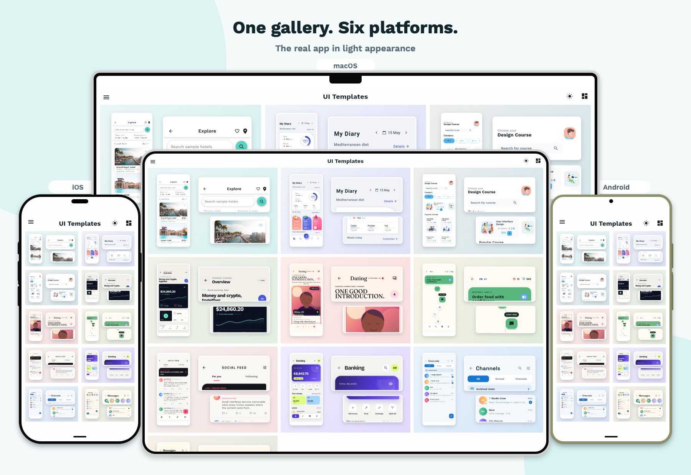
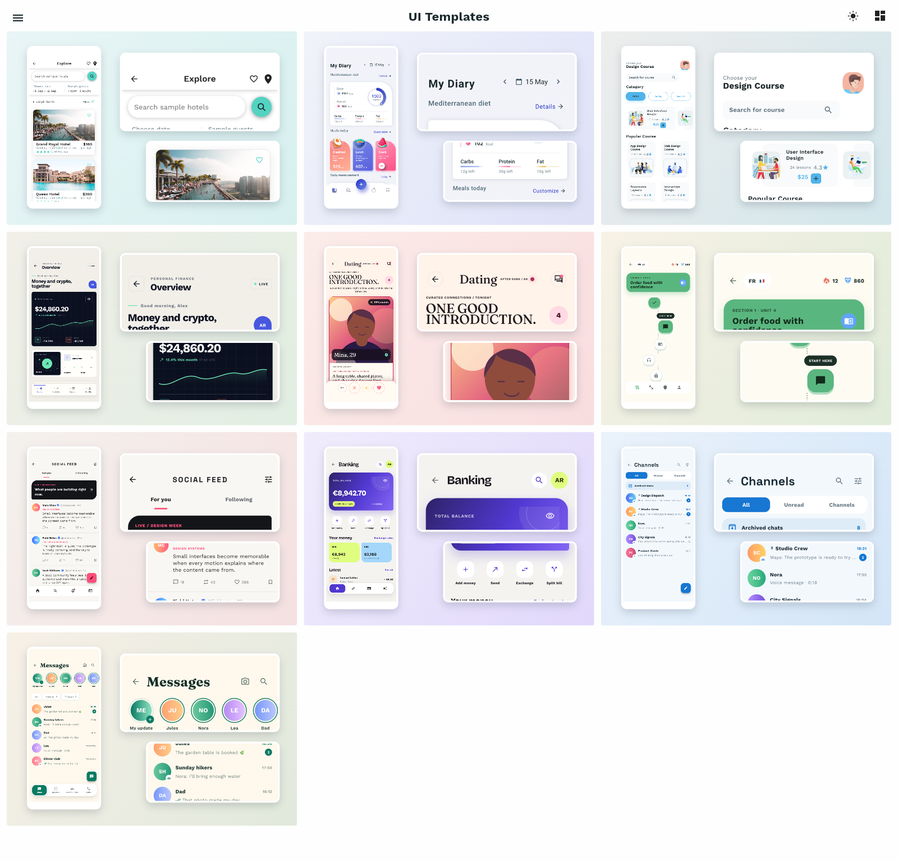
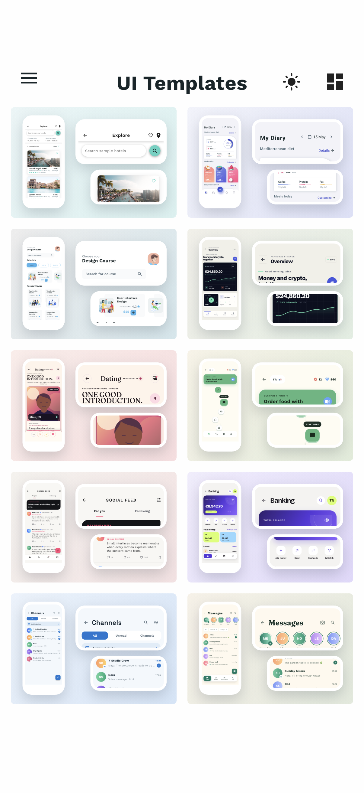

# UI Templates

A free, open-source gallery of Flutter interface examples.

[Try the Flutter web app](https://templates.achim.io).

<picture>
  <source media="(prefers-color-scheme: dark)" srcset="screenshots/readme-hero-dark.png">
  <source media="(prefers-color-scheme: light)" srcset="screenshots/readme-hero-light.png">
  
</picture>

The public app has no private backend or telemetry integration; feedback opens a simple support-email draft.

## Run

```sh
fvm flutter pub get
fvm flutter run
```

## Mobile Code Push

Ordinary debug builds need no Shorebird account, CLI, or environment variables.
Only the optional Shorebird release and patch workflows prepare a Shorebird configuration.
The app identifier is bundled into the released app, but is not checked into this repository.
Web and desktop builds are unchanged.

In this application's [Codemagic environment variables](https://codemagic.io/apps), use the
app-local group `shorebird` for `SHOREBIRD_TOKEN` (secret, a current
[console API key](https://docs.shorebird.dev/account/api-keys/)) and `SHOREBIRD_APP_ID`
(the public UUID generated by one-time app registration).
The build creates ignored `shorebird.yaml` and adds it to the asset list in the disposable runner checkout.
Missing or malformed identifiers stop the Shorebird workflow; there is no shared template app ID or placeholder.

`ios` (**iOS**) and `android` (**Android**) use standard Flutter and need no Shorebird variables or configuration.
Only `ios` is automatic on `main`; all Shorebird workflows are manual opt-ins.
`ios_shorebird` (**iOS Shorebird**) and `android_shorebird` (**Android Shorebird**) create patchable baselines
with Shorebird's latest supported Flutter fork (`--flutter-version=latest`), not the runner's ordinary SDK.
Both release routes retain the same signing and publishers: iOS submits to TestFlight and Android to Play internal.
All mobile workflows have explicit readable names and matching build-list labels.
Standard releases cannot receive patches, even after an occasional Shorebird test.
Choose one release route per commit because both routes derive the same store build number.
For an iOS Shorebird test on `main`, cancel the automatic standard build before upload and start **iOS Shorebird**;
do not reuse a build already uploaded to TestFlight.
The manual `ios_shorebird_patch` (**iOS Shorebird Patch**) and
`android_shorebird_patch` (**Android Shorebird Patch**) workflows ask for `release_version` (exact app version plus build),
and **Dry-run** (`dry_run`, off by default, to validate without uploading).
Both workflows always publish to `staging`; there is no track selector or direct production publication.
Dry-run still requires an existing real Shorebird release.
Patches do not publish new store binaries and cannot change native code or assets.
Before production use, verify signed store packaging and patch delivery on physical hardware.
TestFlight installation alone does not subscribe to staging patches;
connect an unlocked test device and use the authenticated CLI with the same registered app ID:
`shorebird preview --app-id '<registered-app-id>' --platform ios --release-version 1.0.0+123 --track staging`.
Replace the placeholders with the existing Codemagic app ID and exact release version and build;
use `android` for an Android device. Preview reinstalls the app and clears its data; use disposable test data.
After download, fully close and reopen the app, then verify the fix.
See [Shorebird's preview instructions](https://docs.shorebird.dev/code-push/preview/#previewing-patches).
After verification, open the app and release in [Shorebird Console](https://console.shorebird.dev) and select
the patch's **⋮ → Change Track → stable** to serve the same tested patch to production.
The retired Shorebird CI service is not used.

## Gallery

Ten reusable examples with system, light, and dark appearances across six Flutter platforms.

### Web

<picture>
  <source media="(prefers-color-scheme: dark)" srcset="screenshots/web-gallery-dark.png">
  <source media="(prefers-color-scheme: light)" srcset="screenshots/web-gallery-light.png">
  
</picture>

### Mobile

<picture>
  <source media="(prefers-color-scheme: dark)" srcset="screenshots/gallery-dark.png">
  <source media="(prefers-color-scheme: light)" srcset="screenshots/gallery-light.png">
  
</picture>

## License and attribution

Based on [Best Flutter UI Templates](https://github.com/mitesh77/Best-Flutter-UI-Templates). See [`LICENSE`](LICENSE) and [`THIRD_PARTY_NOTICES.md`](THIRD_PARTY_NOTICES.md).
